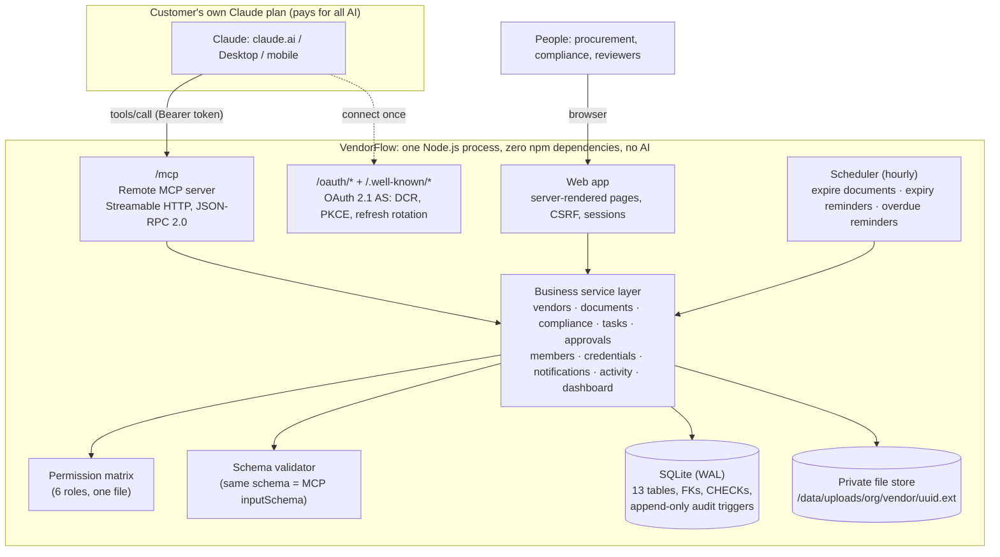
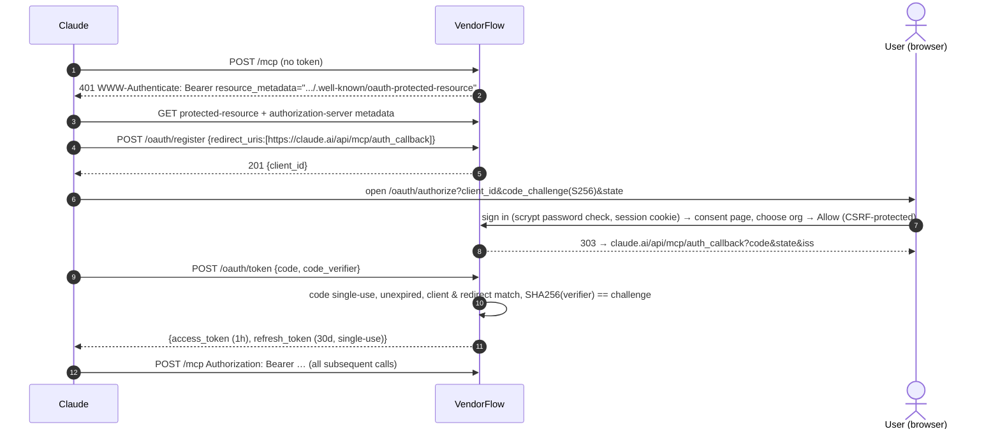
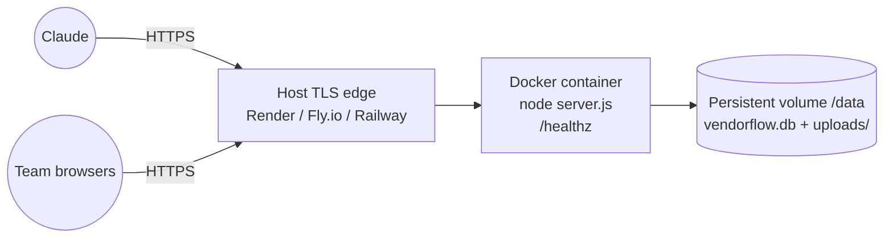

# VendorFlow architecture

> **Claude does the thinking. VendorFlow does the work. The business continues after the chat ends.**

## 1. System architecture



**Key decisions**

| Decision | Why |
|---|---|
| MCP and the web app share one service layer | Zero duplicated business logic: the same rule (e.g. "approval needs 100% compliance") governs Claude and humans. |
| Stateless Streamable HTTP (POST → `application/json`) | No sticky sessions or SSE needed; it works behind any HTTPS proxy, and each request is authenticated independently. |
| OAuth 2.1 with Dynamic Client Registration | Claude's connector flow: the user signs in and picks an org. No keys to paste, no credentials in URLs. |
| Tokens bound to one user plus one org | Tenant isolation is enforced before any tool runs; every action is attributable ("Priya Nair via Claude"). |
| Files only via the web app | Registering metadata is not the same as receiving a document. Compliance counts only uploaded, verified, unexpired files. |
| Zero npm dependencies (Node 22 `node:sqlite`, `node:http`, `node:crypto`) | Built in an environment without package installs, so there's no supply-chain surface. It boots anywhere Node 22 runs. |

## 2. MCP communication flow

```mermaid
sequenceDiagram
  autonumber
  actor U as User
  participant C as Claude
  participant M as VendorFlow /mcp
  participant S as Service layer
  participant D as SQLite
  U->>C: "Create a vendor called ABC Technologies, category Technology"
  C->>M: POST /mcp tools/call create_vendor {company_name, category, contact_person}
  M->>M: Verify Bearer token (hash lookup, expiry, membership) + rate limit
  M->>M: Validate arguments against the tool's JSON Schema
  M->>S: vendors.create(ctx = {org, user, role, actor: "Priya via Claude"}, input)
  S->>S: Permission check (vendor.write) and duplicate check (name, GSTIN)
  S->>D: BEGIN; next VF-#### from org sequence; INSERT vendor; INSERT activity; INSERT notifications; COMMIT
  S-->>M: Persisted vendor + compliance + app_url
  M-->>C: result {content:[text JSON], structuredContent}
  C-->>U: "Created ABC Technologies (VF-1013). Open it: https://…/vendors/VF-1013"
  U->>U: Opens VendorFlow, edits, uploads documents
```

Errors come back as `isError: true` results with a human-readable reason (validation, not found, ambiguous, forbidden, invalid state), so Claude can correct itself or ask the user. Unexpected errors return a reference ID and nothing is saved, because every write runs in a transaction.

## 3. Authentication flows



Web sessions: random 256-bit token in an `HttpOnly; SameSite=Lax` cookie (`Secure` on https), stored as SHA-256, 7-day expiry, per-session CSRF token on every form. Logins are throttled per IP and email.

## 4. Database (ER diagram)

```mermaid
erDiagram
  organizations ||--o{ organization_members : has
  profiles ||--o{ organization_members : "belongs via"
  organizations ||--o{ vendors : owns
  vendors ||--o{ vendor_documents : has
  vendors ||--o| compliance_checklists : has
  compliance_checklists ||--o{ compliance_checklist_items : requires
  organizations ||--o{ compliance_requirements : "templates by category"
  vendors ||--o{ review_tasks : about
  profiles ||--o{ review_tasks : assigned
  vendors ||--o{ approval_requests : for
  profiles ||--o{ approval_requests : approves
  profiles ||--o{ notifications : receives
  organizations ||--o{ activity_logs : "append-only"
  profiles ||--o{ mcp_credentials : "API keys / OAuth tokens"
  oauth_clients ||--o{ oauth_codes : issues
  profiles ||--o{ sessions : has

  vendors { text id PK; text org_id FK; text vendor_code "VF-1001 unique per org"; text company_key "dedupe"; text gst_number "unique per org"; text status "CHECK 7 states"; text risk; text manager_id FK }
  vendor_documents { text id PK; text vendor_id FK; text category "CHECK 9"; text file_path "private"; text status "CHECK"; text expiry_date; text verified_by FK }
  compliance_checklist_items { text checklist_id FK; text doc_category "unique per checklist"; int mandatory }
  approval_requests { text id PK; text vendor_id FK; text approver_id FK; text status "one pending per vendor (partial unique index)" }
  activity_logs { text org_id FK; text actor_type "user|mcp|system"; text action; text entity_type; text entity_id; text metadata }
  mcp_credentials { text token_hash "SHA-256 only"; text kind "api_key|oauth_access|oauth_refresh"; text expires_at; text revoked_at }
```

The full DDL is in [`src/migrations/001_init.sql`](../src/migrations/001_init.sql). Notable constraints: `UNIQUE(org_id, vendor_code)`, `UNIQUE(org_id, company_key)`, a partial unique index on `(org_id, gst_number)`, a partial unique index allowing **one pending approval per vendor**, `CHECK` constraints on every status enum, and `BEFORE UPDATE/DELETE` triggers that make `activity_logs` append-only.

**Tenant isolation.** SQLite has no row-level security, so isolation is enforced in the **only** data-access path, the service layer: every query is filtered by `org_id` from the authenticated context, and identifiers (vendor codes, UUIDs, names) are always resolved *within* the org. Cross-tenant access is covered by automated tests at the service, MCP and HTTP levels (`tests/services.test.js`, `tests/mcp.test.js`, `tests/e2e.test.js`).

## 5. Compliance engine

```
compliance % = verified & unexpired mandatory requirements ÷ all mandatory requirements × 100
```

For each checklist requirement, VendorFlow looks at that vendor's documents of the same category and picks the best one (verified > pending > awaiting file > rejected > expired). The requirement's state is then:

| State | Meaning | Counts? |
|---|---|---|
| Missing | No document, or only a registered "awaiting file" record | No |
| Pending | File uploaded, not yet verified | No |
| Verified | Verified by an authorised reviewer and not expired | **Yes** |
| Rejected | Rejected with a reason | No |
| Expired | Past expiry date, whatever its stored status | No |

The scheduler persists expiries hourly and sends idempotent reminders 30 days ahead and on overdue tasks. That is the part of the product that keeps working with no chat open.

## 6. Deployment architecture



A single instance with a persistent volume. That fits SQLite, and it's adequate for hundreds of SME tenants at this stage. **Scale path:** move `src/db.js` to Postgres (the SQL is portable; RLS policies can then mirror the service-layer org filter), move uploads to object storage with signed URLs, and run stateless app replicas. No business logic changes, because it all sits behind the service layer.

## 7. Deviations from the original brief (and why)

The brief specified Next.js + Supabase + the official MCP SDK. This build was produced in a workspace **without package-registry access**, so no npm packages could be installed. Rather than ship untested code, every layer was implemented on the Node 22 standard library and verified end to end:

| Brief | Built | Equivalent guarantee |
|---|---|---|
| Next.js / React / shadcn / Recharts | Server-rendered HTML, hand-written CSS, SVG charts | Same pages and states; works without JS; CSP `script-src 'self'` |
| Supabase Postgres + RLS | SQLite (WAL) + org-scoped service layer | FKs, CHECKs, unique and partial indexes, transactions; isolation tested |
| Supabase Auth | scrypt passwords, hashed server-side sessions, CSRF | Equivalent web-auth properties |
| Supabase Storage + signed URLs | Private disk, permission-checked streaming, magic-byte type checks | Files are never publicly addressable |
| Official TS MCP SDK | Hand-written Streamable HTTP JSON-RPC server (protocol 2024-11-05 → 2025-11-25) | initialize / tools/list / tools/call / ping / batches / notifications tested |
| Zod | Built-in JSON-Schema validator | One schema is both enforced and published to Claude |

Not built in this version: password-reset email (owners reset access from Team Members), email notifications (in-app only), per-user notification preferences, document version history beyond the audit log, and organisation deletion.
